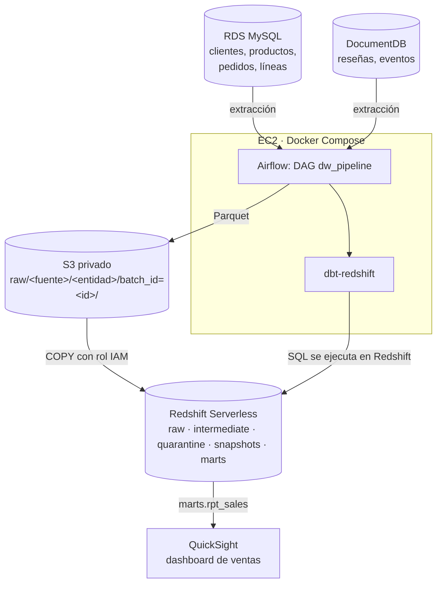

# Data Warehouse de e-commerce en AWS — Ingeniería de Datos 2026-2 (Universidad EIA)

> **Guía de entrega:** este README resume la arquitectura y el flujo. Para desplegar, ejecutar y eliminar recursos, siga [`docs/01_guia_despliegue.md`](docs/01_guia_despliegue.md). Los escenarios y sus resultados esperados están en [`docs/02_escenarios.md`](docs/02_escenarios.md); QuickSight y su KPI, en [`docs/03_quicksight.md`](docs/03_quicksight.md). Las evidencias de ejecuciones reales están en `evidencias/`.

## Qué se entrega

Un pipeline reproducible que migra el proyecto local DE-DW a AWS. Extrae datos relacionales y documentales, conserva cada lote en S3, carga a Redshift, transforma con dbt desde Airflow en EC2 y expone las ventas en QuickSight.

| Parte evaluada | Implementación | Evidencia/código |
|---|---|---|
| Fuentes | RDS for MySQL y Amazon DocumentDB | `infra/cli/03_bases.sh`, `evidencias/03_*.txt` |
| Lotes y almacenamiento | S3 privado, Parquet, manifiestos y marcas de agua | `src/ecommerce_dw/pipeline/`, `evidencias/10_s3_raw.txt`, `evidencias/E4_manifiesto.json` |
| Warehouse | Redshift Serverless con `COPY` usando rol IAM; capas raw, intermediate, quarantine y marts | `src/dbt/`, `evidencias/04_*.txt`, `evidencias/10_evidencias_redshift.txt` |
| Orquestación | DAG Airflow en EC2, extracción, dbt, pruebas, conciliación y registro de lote | `dags/dw_pipeline.py`, `evidencias/06_ec2.txt` |
| Calidad y recuperación | Cuarentena, pruebas dbt, idempotencia, incrementalidad, SCD2 y reejecución | `evidencias/E3_*`, `E4_*`, `E5_*`, `E6_*` |
| Consumo BI | Vista `marts.rpt_sales` y dashboard QuickSight | `docs/03_quicksight.md`, `sql/validacion_kpi.sql`, `evidencias/quicksight_validacion.txt` |

## Cómo leer el repositorio

1. Empiece por este resumen y el diagrama de arquitectura que aparece abajo.
2. Revise `docs/01_guia_despliegue.md` para conocer prerrequisitos, comandos y limpieza de recursos.
3. Use `docs/02_escenarios.md` junto con los archivos `E3` a `E6` para verificar las pruebas de la actividad.
4. Revise `docs/03_quicksight.md` para construir y validar el dashboard. La consulta SQL de validación está en `sql/validacion_kpi.sql`.
5. Consulte `docs/04_decisiones_y_diferencias.md`, `docs/05_costos_seguridad.md` y `docs/modelo_datos.md` para las decisiones, seguridad, costos y modelo dimensional.

Los archivos de evidencia documentan ejecuciones realizadas; las capturas complementan el código y las instrucciones reproducibles, pero no las reemplazan.

Migración a AWS del proyecto local **DE-DW** (MySQL + MongoDB → DuckDB con dbt y Airflow),
conservando sus reglas de negocio, el modelo dimensional (constelación de 3 hechos y 6 dimensiones),
las capas `raw → intermediate → quarantine → marts` y el historial SCD tipo 2.

| Local (DE-DW) | AWS (este repositorio) |
|---|---|
| MySQL en Docker | **Amazon RDS for MySQL 8.0** |
| MongoDB en Docker | **Amazon DocumentDB 5.0** |
| CSV temporales en disco | **Amazon S3** privado (Parquet por lote) |
| DuckDB | **Amazon Redshift Serverless** (`COPY` + dbt-redshift) |
| Airflow en WSL | **Airflow + dbt en una EC2** (Docker Compose) |
| DBeaver | **Amazon QuickSight** (dashboard) + Redshift Query Editor v2 |

## Arquitectura



## DAG `dw_pipeline` (Airflow)

```
validate_connections → extract_mysql_{customers,products,orders,order_items}
                     → extract_mongodb_{reviews,navigation_events} → register_batch → load_raw_redshift
→ dbt_deps → dbt_seed → dbt_run_intermediate → dbt_run_quarantine → dbt_snapshot → dbt_run_marts
→ dbt_test → reconcile_sales_kpi → refresh_quicksight → record_batch
```

| Requisito 3.4 | Tarea |
|---|---|
| 1. Validación de conexiones y parámetros | `validate_connections` (S3, RDS, DocumentDB, Redshift, rol de COPY, lote a reprocesar) |
| 2. Extracción de las fuentes | `extract_<fuente>_<entidad>` (6 tareas, log por entidad) |
| 3. Escritura de archivos en S3 | dentro de cada extracción + `register_batch` (manifiesto del lote) |
| 4. Carga a Redshift | `load_raw_redshift` (`DELETE` del lote + `COPY ... FORMAT AS PARQUET` en una transacción) |
| 5. Transformaciones y snapshots de dbt | `dbt_seed` → `dbt_run_intermediate` → `dbt_run_quarantine` → `dbt_snapshot` → `dbt_run_marts` |
| 6. Pruebas de calidad | `dbt_test` + `reconcile_sales_kpi` (conciliación origen vs modelo) |
| 7. Registro del resultado | `record_batch` (siempre corre; `PROCESSED`/`FAILED` y marcas de agua) |

Dependencias explícitas, `max_active_runs=1`, reintentos acotados (2, backoff exponencial), logs con
`[batch=<id>]`, y sin intervención manual entre etapas. Parámetros: `reprocess_batch_id`, `extraction_mode`.

## Documentación

| Documento | Para qué |
|---|---|
| [docs/01_guia_despliegue.md](docs/01_guia_despliegue.md) | **Paso a paso** completo: desplegar, ejecutar, evidencias y eliminar |
| [docs/02_escenarios.md](docs/02_escenarios.md) | Los 6 escenarios de la sección 3.5 con comandos y evidencias |
| [docs/03_quicksight.md](docs/03_quicksight.md) | Dashboard en QuickSight y consulta SQL de validación del KPI |
| [docs/04_decisiones_y_diferencias.md](docs/04_decisiones_y_diferencias.md) | Decisiones técnicas, MongoDB vs DocumentDB, DuckDB vs Redshift, lotes y marcas de agua |
| [docs/05_costos_seguridad.md](docs/05_costos_seguridad.md) | Estimación de costos y controles de seguridad |
| [docs/modelo_datos.md](docs/modelo_datos.md) | Modelo dimensional (heredado de DE-DW) |

## Estructura

```
dags/dw_pipeline.py                 DAG de Airflow
src/ecommerce_dw/connections.py     conexiones a RDS, DocumentDB y Redshift (desde variables de entorno)
src/ecommerce_dw/pipeline/          extracción a S3, carga COPY, estado/marcas de agua, conciliación
src/ecommerce_dw/sources/           generador de datos, lotes diarios y cambios SCD2 (adaptados a AWS)
src/dbt/                            proyecto dbt adaptado a Redshift (perfil sin secretos)
sql/                                validación del KPI, evidencias y consultas analíticas
tools/                              sql.py (consultas a Redshift) y usuario de sólo lectura para QuickSight
infra/cli/                          despliegue con AWS CLI: 01…07, pausar, reanudar, 99_destroy
docker/                             imagen Airflow + dbt-redshift y docker-compose
tests/local_e2e.py                  prueba completa sin AWS (S3 simulado + PostgreSQL en lugar de Redshift)
.env.example                        variables requeridas (sin valores reales)
```

## Prueba local sin AWS

El proyecto dbt es compatible con Redshift y PostgreSQL (las diferencias de SQL están en macros
`adapter.dispatch`). `tests/local_e2e.py` simula RDS y DocumentDB con el mismo generador de datos,
S3 con `moto`, y corre el proyecto dbt real sobre un PostgreSQL local, recorriendo los 6 escenarios.
